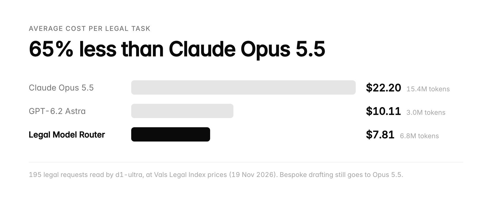
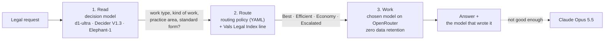

# Legal Model Router

**Cut your legal AI bill by 65%. Keep the flagship model for the work that needs it.**

Most teams send every legal task to one premium model: the NDA, the lease summary, the share purchase
agreement and the billing question all at the same price. The Legal Model Router reads each request, works
out what kind of work it is and which area of law it belongs to, and sends it to the model that leads the
[Vals Legal Index](https://www.vals.ai) for that work, at that work's price. Bespoke drafting still goes to
Claude Opus 5.5. Everything else stops paying Opus prices.

Every request is read by a top decision model on [Vals ClaimBench](https://www.vals.ai/benchmarks/claimbench):
d1-ultra (100%) by default, Decider V1.3 (99.8%, free) or Elephant-1 if you prefer.

One OpenRouter key. One command: `/legal-router` in Claude Code. Zero data retention on every call.

[](LICENSE)


---

## What it saves

<picture>
  <source media="(prefers-color-scheme: dark)" srcset="docs/assets/savings-dark.png">
  
</picture>

195 legal requests (research, contracts, filings, reviews, extractions, summaries, translations, admin),
each read by d1-ultra and priced at the Vals Legal Index cost of the model it was sent to:

| Sending every request to | Cost per task | Tokens per task | The router costs |
|---|---|---|---|
| Claude Opus 5.5 | $22.20 | 15.4M | **65% less, with less than half the tokens** |
| GPT-6.2 Astra | $10.11 | 3.0M | **23% less** |
| **Legal Model Router** | **$7.81** | 6.8M | |

- **$14,390 saved on every 1,000 tasks** against an all-Opus 5.5 setup.
- **Research and advice cost 70% less** than on Opus 5.5, on each line's best model that knows the law.
- **Extraction, summaries, translation and admin cost 78% less** than on Opus 5.5: $4.92 a task against $22.12.
- **Everything except bespoke drafting costs 73% less than Opus 5.5** and 9% less than Gemini 4 Neon, the
  overall #1, because each line's work goes to that line's best-value model.
- **Reading a request costs $0.00014** with d1-ultra, nothing with Decider V1.3.

Reproduce it with `uv run python scripts/estimate_savings.py [--classifier NAME]`: no key, no network. Prices are Vals Legal
Index task prices (19 November 2026); your bill scales with the size of your requests.

## Why one model is the wrong default

No single model wins legal work. On the Vals Legal Index the leader changes from one area of law to the
next, and so does the price:

| Vals line | #1 | Score | Cost per task | Claude Opus 5.5 on the same task |
|---|---|---|---|---|
| Real Estate | Gemini 4 Carbon | 97.7 | $7.12 | $24.84 |
| Labor & Employment | Muse Wonder | 93.1 | $7.28 | $17.13 |
| Tax | Gemini 4 Neon | 79.8 | $4.95 | $14.40 |
| Civil Negligence | Gemini 4 Argon | 74.0 | $9.09 | $24.34 |
| Family | Gemini 4 Carbon | 45.5 | $12.65 | $25.84 |

A single premium model overpays on routine work. A single cheap model fails the matters that turn on the
law. The router tells the two apart, request by request.

## How it works



### 1. Read: what is this work?

A decision model answers a fixed set of multiple-choice questions about the request and returns a
probability for every option, not just a label:

- **Work type:** legal research or advice, new drafting, work on a document already in the prompt, or work
  that is not legal at all (scheduling, billing).
- **Drafting complexity:** a standard form (NDA, power of attorney, board resolution) or a bespoke document.
- **Kind of work:** research, contract review, markup, data extraction, summary or chronology, translation,
  and more.
- **Practice area:** 26 areas, from M&A and capital markets to immigration and trusts and estates, each
  mapped to its Vals Legal Index line. Anything it cannot place goes to the Vals overall line.

The router reads the probabilities and errs toward the stronger model when it is unsure: a request that is
even 30% likely to need the law or a bespoke draft goes to a top model, and if the kind of work is unclear the request goes to
the overall #1. If the decision model cannot answer at all, the request still runs, on the overall #1.

#### Choose your decision model

| Name | Model | Vals ClaimBench | Our holdout | Reads a request for |
|---|---|---|---|---|
| `d1-ultra` (default) | [liquid/d1-ultra](https://openrouter.ai/liquid/d1-ultra) | 100.0% | **55/55** | $0.00014 |
| `decider-v1.3` | [perplexity/pplx-decider-v1.3](https://openrouter.ai/perplexity/pplx-decider-v1.3) | 99.8% | 53/55 | free |
| `elephant-1` | [baseten/elephant-1](https://openrouter.ai/baseten/elephant-1) | 97.3% | 52/55 | $0.00014 |

All three send every law-dependent request and every bespoke draft in our test sets to a top model. Pick one with
`legal-router init`, `--classifier NAME`, `LEGAL_ROUTER_CLASSIFIER`, or the plugin's "Decision model"
setting. Only measured models are accepted; [`docs/evaluation.md`](docs/evaluation.md) has the comparison.

#### Long requests

Long requests are not cut short for the worker. The classifier sees both ends of a long request (where the
instruction sits); the model doing the work always gets all of it.

### 2. Route: which model?

Each Vals line has four picks, rebuilt from the benchmark data by one script:

| Pick | Gets | How the model is chosen |
|---|---|---|
| **Best** | Research and advice, anything that turns on the law | The #1 on the line among models that pass a law gate, or one within 2 points of it that costs at least 25% less |
| **Efficient** | Standard-form drafting; review and markup of supplied text | The cheapest of the line's top 5 within 3 points of #1 |
| **Economy** | Extraction, summaries, chronologies, translation, admin | The cheapest model within 8 points of #1 that uses no more tokens than #1, and never dearer than Best |
| **Escalated** | Bespoke drafting from scratch, and every send-back | Claude Opus 5.5 |

The rules live in one readable file, [`config/routing-policy.yaml`](config/routing-policy.yaml). The full
table they produce, with every score, cost and token count, is in
[`config/routing-table.md`](config/routing-table.md).

### 3. Work: the call

The chosen model is called through OpenRouter at the reasoning effort its Vals score was earned at. The
answer comes back with the model's name, its pick and the Vals line, so you always know who wrote it.

### Send-back

When a lawyer says an answer is not good enough, the same task goes to Claude Opus 5.5 with their comment,
whatever the original route. No benchmark average outweighs a lawyer's rejection.

## Three benchmarks, one decision

The router does not trust a single leaderboard. Each source answers a different question:

| Source | What it decides |
|---|---|
| [Vals Legal Index](https://www.vals.ai) | The main source. Accuracy, cost and tokens per task on 9 practice-area lines and overall. It picks the pool, the #1 and every cheaper rung. |
| [Artificial Analysis](https://artificialanalysis.ai) | The law gate. Best must score at least 55 on legal knowledge and 65 on non-hallucination, so a model that writes well but invents law never handles research. |
| [legalbenchmarks.ai](https://www.legalbenchmarks.ai) | Contract drafting. No Vals line measures drafting from nothing; here Claude Opus 5.5 is joint #1, which is why bespoke drafting and send-backs go to it. |

The pool is limited to the flagship models of major labs (Google, Meta, Anthropic, OpenAI, xAI) that
OpenRouter serves with zero data retention. Today's routes:

| Vals line | Best | Efficient | Economy |
|---|---|---|---|
| Overall (area unknown) | Gemini 4 Neon | Gemini 4 Neon | Muse Wonder |
| Business & Commercial | Gemini 4 Neon | Gemini 4 Neon | Muse Wonder |
| Civil Negligence | Gemini 4 Neon | Gemini 4 Hydrogen | Gemini 4 Neon |
| Other Civil | Gemini 4 Neon | Gemini 4 Neon | Muse Wonder |
| Real Estate | Gemini 4 Carbon | Gemini 4 Hydrogen | GPT-6.2 Sol |
| Labor & Employment | Gemini 4 Neon | GPT-6.2 Astra | GPT-6.2 Sol |
| Wills, Estates & Trusts | Gemini 4 Neon | Gemini 4 Hydrogen | GPT-6.2 Sol |
| Family | Gemini 4 Carbon | Gemini 4 Carbon | Gemini 4 Carbon |
| Criminal | Gemini 4 Carbon | Gemini 4 Neon | Grok 4.7 |
| Tax | Gemini 4 Neon | Gemini 4 Argon | Gemini 4 Argon |

Escalated is Claude Opus 5.5 on every line.

## Privacy: zero data retention on every call

Every OpenRouter request the router makes, the classifier's included, carries
`provider: {"zdr": true, "data_collection": "deny"}`: it can only reach endpoints that keep no prompts and
it forbids prompt collection. The worker call also sets `allow_fallbacks: false` and
`require_parameters: true`, so the request is never silently moved to another provider or stripped of its
settings. `legal-router doctor` checks that every model in the table still has a zero-retention endpoint.

The router itself stores nothing: no logs, no prompts, no answers. Your key is sent only to OpenRouter.

## Install

You need an [OpenRouter API key](https://openrouter.ai/keys).

### In Claude Code (the plugin)

```text
/plugin marketplace add onurkafk/legal-model-router
/plugin install legal-router@legal-router
```

Claude Code asks for your OpenRouter key once and keeps it in your system's credential store. The plugin
needs [uv](https://docs.astral.sh/uv/) on your PATH. Then ask for legal work in plain words, or call it
directly with `/legal-router:legal-router <task>`. Say "not good enough" and why, and the answer goes back
to Claude Opus 5.5.

### From the command line (pipx)

```bash
pipx install git+https://github.com/onurkafk/legal-model-router
legal-router init       # saves your key to ~/.legal-router/config.json (readable only by you) and checks it
legal-router claude     # optional: adds the bare /legal-router command and the tool to Claude Code
```

| Command | What it does |
|---|---|
| `legal-router route "<task>"` | Shows which model would take a task, without running it (one classifier call) |
| `legal-router serve` | An OpenAI-compatible endpoint at `http://127.0.0.1:8404/v1` |
| `legal-router mcp` | The router as an MCP tool, for any MCP client |
| `legal-router doctor` | Checks the key, the classifier and zero data retention |

### As an endpoint for your own tools

Point any OpenAI-compatible client at `legal-router serve` and use the model `legal-router/auto`, or
`legal-router/best` to skip the cheaper picks:

```bash
curl http://127.0.0.1:8404/v1/chat/completions -H 'Content-Type: application/json' -d '{
  "model": "legal-router/auto",
  "messages": [{"role": "user", "content": "Is a five-year non-compete enforceable in California?"}]
}'
```

The response headers `X-Legal-Router-Model`, `X-Legal-Router-Pick` and `X-Legal-Router-Line` name the
route. Streaming works. To send an answer back, repeat the conversation with the lawyer's comment as the
last user message and add `"legal_router": {"sent_back": true}`.

### In Python

```python
from legal_router import classify, route, complete

work = classify("Draft a share purchase agreement for a German GmbH, buyer-friendly")   # classifier="decider-v1.3" to choose
print(route(work).public())   # {'model': 'anthropic/claude-opus-5.5', 'pick': 'escalated', ...}

response, r = complete("Summarise this lease into a table of dates and obligations: ...")
print(r.model, r.pick, r.line)
```

The key comes from the `key=` argument, then `OPENROUTER_API_KEY`, then `legal-router init`'s file.

## Cheap where it can be, never where it matters

The savings come without sending law-dependent work down. On a fresh holdout of 55 legal requests and a
stress set of 116 hard ones (full figures in [`docs/evaluation.md`](docs/evaluation.md)):

- **31 of 31** holdout requests that need the law or a bespoke draft went to a top model.
- **28 of 28** law-dependent stress requests were caught.
- **0 of 13** bespoke drafts were sent to a cheaper model.
- **52 of 195** requests ran on the Economy pick, **30** on Efficient: that is where the money is saved.

## Changing the routing

The policy is yours to change. Edit [`config/routing-policy.yaml`](config/routing-policy.yaml) (which
models are allowed, the thresholds, the rules) or refresh the benchmark snapshots in
[`benchmarks/`](benchmarks), then rebuild:

```bash
uv run python scripts/build_routing_table.py      # rewrites config/routing-table.{json,md} and the package copy
uv run pytest                                      # checks the table still obeys the policy
```

Review the diff of `config/routing-table.md` before you ship it.

## Development

```bash
git clone https://github.com/onurkafk/legal-model-router && cd legal-model-router
uv sync
uv run pytest
```

## License

[MIT](LICENSE). Benchmark figures belong to their publishers: Vals AI, Artificial Analysis and
legalbenchmarks.ai. The router picks models; a lawyer signs off the work.
